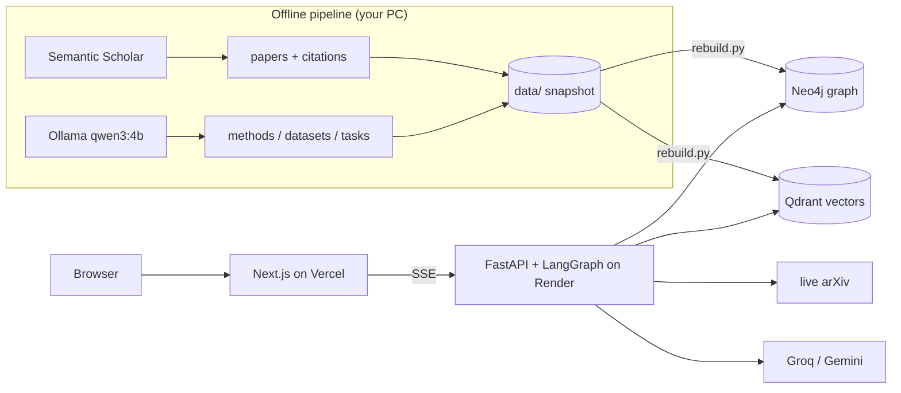

# PaperWeave

> **See how AI research connects.**

PaperWeave is an agentic GraphRAG research assistant for AI/LLM papers. Ask a research question and a LangGraph agent combines a knowledge graph of papers, methods and datasets with semantic search and live arXiv search. It answers with citations and shows you the graph behind every answer.



**Status:** Weeks 1–3 are built. Week 1 (data pipeline) is done. The graph holds 500 papers, 4,829 authors, 4,172 citations and 2,653 LLM-extracted methods, datasets and tasks in Neo4j. Papers are indexed in Qdrant for hybrid (dense + BM25) search, and `rebuild.py` restores both databases from the `data/` snapshot. Week 2 (agent + backend) is built: a LangGraph agent with graph, search and live arXiv tools behind a streaming FastAPI API. Week 3 is the Next.js frontend, evals and deployment.

## Features

- **Agent that plans before it retrieves.** Each question gets the right tools: knowledge-graph queries, hybrid vector search and live arXiv search. If the evidence is thin, it rewrites the query and retries.
- **Knowledge graph of 500 influential AI/LLM papers**, with citations, methods, datasets, tasks and "improves on" links extracted by a local LLM.
- **Streaming answers with verified arXiv citations.** Garbled IDs are repaired and invented ones removed. Comparison questions get a table.
- **Interactive graph view** of the papers and methods behind each answer, with paper cards and per-paper citation graphs.
- **Evals against vector-only RAG** on 30 golden questions (see [Results](#evaluation)).
- **Public demo with no login**, built for free tiers: saved example answers work even while the backend sleeps.

## Tech stack

| Layer | Tech |
|---|---|
| Frontend | Next.js 16, React 19, Tailwind CSS 4, react-force-graph, react-markdown (Vercel) |
| Backend | FastAPI, LangGraph, Docker (Render) |
| Graph DB | Neo4j AuraDB |
| Vector DB | Qdrant Cloud (hybrid dense + BM25) |
| LLM | Groq (Llama 3.3 70B), Gemini Flash fallback; Ollama for the offline graph build |
| Data | arXiv API, Semantic Scholar API |
| Evals | Golden-question recall and citation recall vs vector-only RAG (`backend/evals`) |

## Project structure

```
pipeline/   offline ingestion: fetch → extract entities → load graph + vectors
data/       snapshot used to rebuild the databases
playground/ toy LangGraph agent (learning step before the real backend)
backend/    FastAPI + LangGraph agent
  app/agent/  plan → retrieve → check → rewrite → answer → subgraph
  app/tools/  hybrid search, Cypher templates + read-only guard, live arXiv
  app/api/    /api/chat (SSE), /api/papers, /api/graph
  tests/      pytest
  evals/      golden questions + agent vs vector-only comparison
  scripts/    export_examples.py (saved answers for the frontend)
frontend/   Next.js app: home, /ask (streaming answer + graph), /paper/[id]
docs/       plan, deployment guide
render.yaml Render blueprint for the backend
.github/    CI (pytest, lint, build) and keep-warm cron
```

## Run the pipeline locally

You need Docker and Python 3.11 or newer.

```bash
cp .env.example .env
docker compose up -d                      # Neo4j (localhost:7474) + Qdrant (localhost:6333)
python -m venv .venv
.venv/Scripts/pip install -r pipeline/requirements.txt   # macOS/Linux: .venv/bin/pip

.venv/Scripts/python pipeline/fetch_papers.py --max-papers 50   # → data/papers.jsonl
.venv/Scripts/python pipeline/fetch_citations.py                # → data/citations.jsonl
.venv/Scripts/python pipeline/extract_entities.py               # → data/entities_raw.jsonl (needs Ollama)
.venv/Scripts/python pipeline/normalize.py                      # → data/entities.jsonl + entity_index.jsonl
.venv/Scripts/python pipeline/load_neo4j.py                     # idempotent upsert
.venv/Scripts/python pipeline/check_graph.py                    # sanity checks
.venv/Scripts/python pipeline/load_qdrant.py                    # hybrid vector index (idempotent)
.venv/Scripts/python pipeline/check_search.py                   # dense vs BM25 vs hybrid results
```

### Rebuild the databases from the snapshot

`data/` holds the full pipeline output, so you can restore both databases without calling Semantic Scholar or Ollama. This is the recovery path if a free-tier database is wiped. Set `NEO4J_*` and `QDRANT_*` in `.env` to point it at production.

```bash
.venv/Scripts/python pipeline/rebuild.py            # upsert into Neo4j + Qdrant
.venv/Scripts/python pipeline/rebuild.py --fresh    # wipe both first
```

### Toy agent

[`playground/toy_agent.py`](playground/toy_agent.py) is a minimal LangGraph agent: an LLM node and a tool node in a loop. It has two tools, hybrid paper search and a graph lineage query, and runs on local Ollama. It's the starting point for the Week 2 agent.

```bash
.venv/Scripts/pip install -r playground/requirements.txt
.venv/Scripts/python playground/toy_agent.py "What improved on RAG, and which datasets did those papers use?"
```

## Backend: agent + API

The backend is a LangGraph agent behind a FastAPI app that streams Server-Sent Events.

```
plan → retrieve → check ──(evidence thin, max 2 retries)──► rewrite → retrieve
                       └──(enough)──► answer → subgraph
```

- **plan**: a fast LLM classifies the question (lineage, compare, dataset, top-cited, recent, graph or lookup) and pulls out the names it mentions. If the LLM fails, a keyword fallback takes over.
- **retrieve**: code, not the LLM, runs the tools that fit the plan:
  - Cypher templates for lineage, comparisons, dataset users and top-cited papers
  - LLM-written Cypher for other graph questions, behind a read-only guard
  - hybrid vector search
  - live arXiv search for "latest" questions, with Semantic Scholar as a fallback
- **check**: if the evidence is thin, the planner rewrites the query and tries again, up to 2 times.
- **answer**: the strong LLM writes a cited answer, with a table for comparisons. Every `[arXiv ID]` is then checked against the evidence: garbled IDs are repaired and invented ones removed.
- **subgraph**: returns the papers, methods and datasets behind the answer for the graph view.

Safety and free-tier limits:
- Every Cypher query runs in a read-only transaction with a 10-second timeout.
- New questions are limited to 15 per hour per IP.
- Repeat questions are served from a SQLite cache.
- `/health` makes a real read on both databases, so uptime pings keep them from pausing.

| Endpoint | What it returns |
|---|---|
| `POST /api/chat` `{"question": "..."}` | SSE stream: `step`, `token`, `answer`, `citations`, `subgraph`, `done` (or `error`) |
| `GET /api/papers/{arxiv_id}` | Paper card: metadata, authors, methods, datasets, citation counts |
| `GET /api/graph/paper/{arxiv_id}` | The paper's neighborhood as graph nodes and links |
| `GET /health` | `200` when Neo4j and Qdrant both answer, else `503` |

```bash
.venv/Scripts/pip install -r backend/requirements-dev.txt
cd backend
../.venv/Scripts/python -m pytest                                   # 41 tests, no databases needed
../.venv/Scripts/python -m app.agent.graph "Compare GraphRAG, RAPTOR and HippoRAG"   # CLI run
../.venv/Scripts/python -m uvicorn app.main:app --reload --port 8010              # API + docs at /docs
```

LLMs are tried in order: Groq, then Gemini, then local Ollama. Put `GROQ_API_KEY` and/or `GOOGLE_API_KEY` in `.env`; with neither, everything runs on Ollama. That works, but takes 1–2 minutes per answer on a laptop GPU, compared with a few seconds on Groq. The production image (`backend/Dockerfile`) uses about 150 MB of RAM, within Render's 512 MB free tier.

## Frontend

A Next.js app with three pages:
- **Home:** an ask box and 10 example questions.
- **`/ask?q=...`:** the agent's steps stream in as a timeline, then a markdown answer with clickable citations, a sources list and the interactive graph behind the answer. Clicking a paper opens its card.
- **`/paper/[id]`:** the paper's abstract, entities and citation neighborhood.

Example questions are served from [`frontend/public/examples.json`](frontend/public/examples.json), generated by `backend/scripts/export_examples.py`. They load instantly and work even when the backend is asleep. If the backend takes more than 4 seconds to respond at all, a "waking up the server" banner explains the free-tier cold start.

```bash
cd frontend
cp .env.example .env.local        # NEXT_PUBLIC_API_URL=http://localhost:8010
npm install
npm run dev                       # http://localhost:3000
```

## Evaluation

[`backend/evals/golden.jsonl`](backend/evals/golden.jsonl) holds 30 questions: 10 lookups, 10 multi-hop and 10 comparisons. Each lists the papers a correct answer must draw on, chosen from what's known about the papers rather than from the extracted graph. Both systems get the same budget: the 12 papers shown to the answer LLM.

- **Vector-only RAG:** the question goes straight into the same hybrid (MiniLM + BM25) search.
- **PaperWeave agent:** planning, graph tools, per-entity search, then the evidence check and retries.

EVAL_RESULTS_PLACEHOLDER

```bash
cd backend
../.venv/Scripts/python -m evals.run_eval             # retrieval metrics only
../.venv/Scripts/python -m evals.run_eval --answers   # also generate and score full answers
```

## Deployment

The whole stack runs on free tiers:
- Neo4j AuraDB and Qdrant Cloud for the databases
- Render (Docker) for the backend
- Vercel for the frontend
- Groq for the LLM
- UptimeRobot, which pings `/health` to keep everything awake

Step-by-step guide: [docs/DEPLOY.md](docs/DEPLOY.md). The Render blueprint is [`render.yaml`](render.yaml).

## Notes on the pipeline

Entity extraction runs a local LLM through [Ollama](https://ollama.com) (`qwen3:4b-instruct` by default; change `OLLAMA_MODEL` in `.env`). It takes about 6–11 seconds per paper on a 4 GB laptop GPU (about 50 minutes for 500 papers) and is resumable: re-running skips papers already done. `normalize.py` merges spellings of the same entity (for example "Hotpot QA" and "HotpotQA", or "NQ" and "Natural Questions") and drops vague names. Review `data/entity_index.jsonl` to see what was merged.

`load_qdrant.py` stores each paper's title and abstract as one point with two vectors: a MiniLM embedding (meaning) and a BM25 sparse vector (exact terms such as "HotpotQA"). Search runs both and merges the rankings with Reciprocal Rank Fusion. Locally, `fastembed` computes the vectors on your CPU; the first run downloads about 100 MB of models. On Qdrant Cloud, set `QDRANT_CLOUD_INFERENCE=true` and the server embeds the text instead, so the backend never loads a model.

Paper metadata and citations come from the [Semantic Scholar API](https://api.semanticscholar.org). Topic searches are sorted by citation count, and every paper keeps its arXiv ID and links. Without an API key, Semantic Scholar allows about 100 requests per 5 minutes, which the scripts pace for automatically.

See [docs/PLAN.md](docs/PLAN.md) for the full plan.
