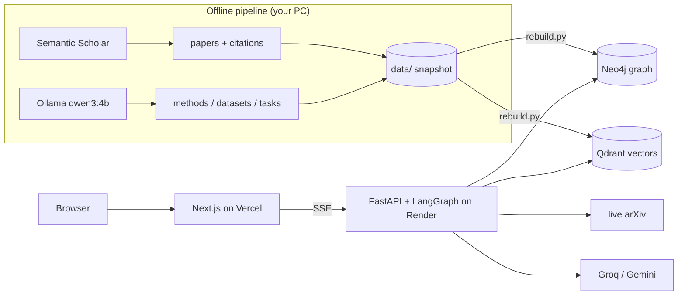

# PaperWeave

> **See how AI research connects.**

PaperWeave is an agentic GraphRAG research assistant for AI/LLM papers. Ask a research question and a LangGraph agent combines a knowledge graph of papers, methods and datasets with semantic search and live arXiv search. It answers with citations and shows you the graph behind every answer.



**Status:** v2 is built: the data pipeline, a LangGraph agent behind a streaming FastAPI API, the Next.js frontend and the evals. The committed snapshot holds **9,153 papers across 30 topics** in AI, CS, physics and math, with 88,968 citation links and 55,756 extracted methods, datasets and tasks. The graph is about 126K nodes and 333K relationships, inside AuraDB Free's limits.

v2 added, over v1's 500 AI/LLM papers:
- coverage of AI, CS, physics and math
- follow-up questions, a trends page and an off-topic guard
- an editorial redesign with a home-page explainer

Not yet deployed.

## Features

- **Agent that plans before it retrieves.** Each question gets the right tools: knowledge-graph queries, hybrid vector search and live arXiv search. If the evidence is thin, it rewrites the query and retries.
- **Knowledge graph of influential arXiv papers across 30 topics** in AI, computer science, physics and math (9,153 papers), with citations, methods, datasets, tasks and "improves on" links extracted by a local LLM.
- **Follow-up questions** ("which datasets did the second one use?"): the agent rewrites them into standalone questions using the conversation so far.
- **Trends from the papers**: fastest-growing topics, methods taking a growing share of papers, and breakout papers. Measurements, never forecasts.
- **Stays on topic**: off-topic requests (chat, coding, writing, news) get a polite pointer to what it covers instead of a made-up answer.
- **Streaming answers with verified arXiv citations.** Garbled IDs are repaired and invented ones removed. Comparison questions get a table.
- **Interactive graph view** of the papers and methods behind each answer, with paper cards and per-paper citation graphs.
- **Evals against vector-only RAG** on 43 golden questions, including physics & math and off-topic ones (see [Results](#evaluation)).
- **Public demo with no login**, built for free tiers: saved example answers work even while the backend sleeps.

## Tech stack

| Layer | Tech |
|---|---|
| Frontend | Next.js 16, React 19, Tailwind CSS 4, react-force-graph, react-markdown (Vercel) |
| Backend | FastAPI, LangGraph, Docker (Render) |
| Graph DB | Neo4j AuraDB |
| Vector DB | Qdrant Cloud (hybrid dense + BM25) |
| LLM | Groq (`openai/gpt-oss-120b` answers, `qwen/qwen3.8-27b` plans), Gemini Flash-Lite fallback; Ollama for the offline graph build |
| Data | arXiv API, Semantic Scholar API |
| Evals | Golden-question recall and citation recall vs vector-only RAG (`backend/evals`) |

## Project structure

```
pipeline/   offline ingestion: fetch → extract entities → load graph + vectors
data/       snapshot used to rebuild the databases
playground/ toy LangGraph agent (learning step before the real backend)
backend/    FastAPI + LangGraph agent
  app/agent/  plan → retrieve → check → rewrite → answer → subgraph
  app/tools/  hybrid search, Cypher templates + read-only guard, live arXiv
  app/api/    /api/chat (SSE), /api/papers, /api/graph
  tests/      pytest
  evals/      golden questions + agent vs vector-only comparison
  scripts/    export_examples.py (saved answers for the frontend)
frontend/   Next.js app: home, /ask (streaming answer + graph), /paper/[id]
docs/       plan, deployment guide
render.yaml Render blueprint for the backend
.github/    CI (pytest, lint, build) and keep-warm cron
```

## Run the pipeline locally

You need Docker and Python 3.11 or newer.

```bash
cp .env.example .env
docker compose up -d                      # Neo4j (localhost:7474) + Qdrant (localhost:6333)
python -m venv .venv
.venv/Scripts/pip install -r pipeline/requirements.txt   # macOS/Linux: .venv/bin/pip

.venv/Scripts/python pipeline/fetch_papers.py --max-papers 50   # → data/papers.jsonl
.venv/Scripts/python pipeline/fetch_citations.py                # → data/citations.jsonl
.venv/Scripts/python pipeline/extract_entities.py               # → data/entities_raw.jsonl (needs Ollama)
.venv/Scripts/python pipeline/normalize.py                      # → data/entities.jsonl + entity_index.jsonl
.venv/Scripts/python pipeline/load_neo4j.py                     # idempotent upsert
.venv/Scripts/python pipeline/check_graph.py                    # sanity checks
.venv/Scripts/python pipeline/load_qdrant.py                    # hybrid vector index (idempotent)
.venv/Scripts/python pipeline/check_search.py                   # dense vs BM25 vs hybrid results
.venv/Scripts/python pipeline/export_stats.py                   # coverage counts for the website
```

Or run everything unattended. Each step resumes where it stopped, so re-run it after an interruption:

```bash
bash pipeline/build_all.sh
```

The topics to cover live in `TOPICS` in [`pipeline/config.py`](pipeline/config.py): each has a field, a Semantic Scholar query and landmark seed papers. `fetch_papers.py` takes the most cited papers per topic **per year** (equal quotas). That keeps recent work from being crowded out, and it makes per-year shares comparable for the trends page. A full 10K-paper build takes several hours of fetching without a free `S2_API_KEY`, then about 18 hours of extraction on a 4 GB laptop GPU (the 9,153-paper snapshot took about 17 hours, over three sittings).

### Rebuild the databases from the snapshot

`data/` holds the full pipeline output, so you can restore both databases without calling Semantic Scholar or Ollama. This is the recovery path if a free-tier database is wiped. Set `NEO4J_*` and `QDRANT_*` in `.env` to point it at production.

```bash
.venv/Scripts/python pipeline/rebuild.py            # upsert into Neo4j + Qdrant
.venv/Scripts/python pipeline/rebuild.py --fresh    # wipe both first
```

### Toy agent

[`playground/toy_agent.py`](playground/toy_agent.py) is a minimal LangGraph agent: an LLM node and a tool node in a loop. It has two tools, hybrid paper search and a graph lineage query, and runs on local Ollama. It's the starting point for the Week 2 agent.

```bash
.venv/Scripts/pip install -r playground/requirements.txt
.venv/Scripts/python playground/toy_agent.py "What improved on RAG, and which datasets did those papers use?"
```

## Backend: agent + API

The backend is a LangGraph agent behind a FastAPI app that streams Server-Sent Events.

```
plan → retrieve → check ──(evidence thin, max 2 retries)──► rewrite → retrieve
                       └──(enough)──► answer → subgraph
```

- **plan**: a fast LLM classifies the question (lineage, compare, dataset, top-cited, recent, trend, graph, lookup or off-topic) and pulls out the names it mentions. If the LLM fails, a keyword fallback takes over.
  - Follow-ups arrive with the last few turns and are first rewritten into a standalone question.
  - Off-topic questions go straight to a fixed, polite explanation of what PaperWeave covers.
- **retrieve**: code, not the LLM, runs the tools that fit the plan:
  - Cypher templates for lineage, comparisons, dataset users and top-cited papers
  - LLM-written Cypher for other graph questions, behind a read-only guard
  - hybrid vector search
  - live arXiv search for "latest" questions, with Semantic Scholar as a fallback
- **check**: if the evidence is thin, the planner rewrites the query and tries again, up to 2 times.
- **answer**: the strong LLM writes a cited answer, with a table for comparisons. Every `[arXiv ID]` is then checked against the evidence: garbled IDs are repaired and invented ones removed.
- **subgraph**: returns the papers, methods and datasets behind the answer for the graph view.

Safety and free-tier limits:
- Every Cypher query runs in a read-only transaction with a 10-second timeout.
- New questions are limited to 15 per hour per IP.
- Repeat questions are served from a SQLite cache.
- `/health` makes a real read on both databases, so uptime pings keep them from pausing.

| Endpoint | What it returns |
|---|---|
| `POST /api/chat` `{"question": "..."}` | SSE stream: `step`, `token`, `answer`, `citations`, `subgraph`, `done` (or `error`) |
| `GET /api/papers/{arxiv_id}` | Paper card: metadata, authors, methods, datasets, citation counts |
| `GET /api/graph/paper/{arxiv_id}` | The paper's neighborhood as graph nodes and links |
| `GET /health` | `200` when Neo4j and Qdrant both answer, else `503` |

```bash
.venv/Scripts/pip install -r backend/requirements-dev.txt
cd backend
../.venv/Scripts/python -m pytest                                   # 41 tests, no databases needed
../.venv/Scripts/python -m app.agent.graph "Compare GraphRAG, RAPTOR and HippoRAG"   # CLI run
../.venv/Scripts/python -m uvicorn app.main:app --reload --port 8010              # API + docs at /docs
```

LLMs are tried in order: Groq's answer model, then Groq's router model (each has its own free daily token quota), then Gemini, then local Ollama. Put `GROQ_API_KEY` and/or `GOOGLE_API_KEY` in `.env`; with neither, everything runs on Ollama. That works, but takes 1–2 minutes per answer on a laptop GPU, compared with a few seconds on Groq. The production image (`backend/Dockerfile`) uses about 150 MB of RAM, within Render's 512 MB free tier.

## Frontend

A Next.js app with five pages:
- **Home:** what it is and who it's for, a real saved answer shown inline, example questions, and coverage per field and topic (from `public/stats.json`).
- **`/trends`:** topic growth, rising methods and breakout papers, filterable by field.
- **`/how-it-works`:** how the pipeline and agent work, the evaluation, and the stack.
- **`/about`:** why PaperWeave exists, who built it, its limits and data credits.
- **`/ask?q=...`:** the agent's steps stream in as a timeline, then a markdown answer with clickable citations, a sources list and the interactive graph behind the answer. Clicking a paper opens its card. A follow-up box continues the conversation.
- **`/paper/[id]`:** the paper's abstract, entities and citation neighborhood.

Example questions are served from [`frontend/public/examples.json`](frontend/public/examples.json), generated by `backend/scripts/export_examples.py`. They load instantly and work even when the backend is asleep. If the backend takes more than 4 seconds to respond at all, a "waking up the server" banner explains the free-tier cold start.

```bash
cd frontend
cp .env.example .env.local        # NEXT_PUBLIC_API_URL=http://localhost:8010
npm install
npm run dev                       # http://localhost:3000
```

**Design.** An editorial "paper & ink" look: warm paper and ink with one vermilion accent, a deep ink-blue dark mode and serif headings. Colors are tokens in `app/globals.css`, and the trends chart colors are checked for color-blind safety. Animated pieces come from [React Bits](https://reactbits.dev) (MIT + Commons Clause), vendored in `components/reactbits/`:
- the woven "Threads" hero background
- the blur-in headline
- spotlight cards
- count-up numbers

All animation respects the OS "reduce motion" setting.

## Evaluation

[`backend/evals/golden.jsonl`](backend/evals/golden.jsonl) holds 43 questions:
- 30 on AI research: 10 lookups, 10 multi-hop and 10 comparisons
- 10 on physics & math, such as quantum error correction, LIGO, DESI and conformal prediction
- 3 off-topic questions the agent should decline

Each scored question lists the papers a correct answer must draw on, chosen from what's known about the papers rather than from the extracted graph. Both systems get the same budget: the 12 papers shown to the answer LLM.

- **Vector-only RAG:** the question goes straight into the same hybrid (MiniLM + BM25) search.
- **PaperWeave agent:** planning, graph tools, per-entity search, then the evidence check and retries.

**Results** (9,153-paper library; local `qwen3:4b-instruct` via Ollama for planning and answers):

| Questions | n | Context recall: vector-only → agent | Hit rate: vector-only → agent | Citation recall: vector-only → agent |
|---|---|---|---|---|
| All | 40 | 71% → **82%** | 85% → **92%** | 69% → **78%** |
| Lookup | 17 | 100% → **100%** | 100% → **100%** | 100% → **94%** |
| Multi-hop | 11 | 32% → **42%** | 55% → **73%** | 29% → **39%** |
| Comparison | 12 | 65% → **92%** | 92% → **100%** | 61% → **92%** |
| Physics & math | 10 | 95% → **95%** | 100% → **100%** | 95% → **95%** |

Off-topic questions declined: **3/3**. The physics & math row overlaps the others: its questions are also counted under lookup, multi-hop or comparison.

- **Context recall:** the share of gold papers in the answer LLM's context.
- **Hit rate:** the share of questions with at least one gold paper in context.
- **Citation recall:** the share of gold papers the final answer cites.

What the numbers show:
- **The graph helps most where vector search can't follow links.**
  - Comparisons went from 65% to 92%: the agent finds each method's defining paper even when the name never appears in its abstract, as with DPR.
  - "Which papers build on *Attention Is All You Need*?" went from 0% to 60%, via citation edges.
  - "Which retrieval-augmented models were evaluated on Natural Questions?" went from 20% to 100%, via `EVALUATES_ON` edges.
- **Lookups stay easy, also outside AI.** Both systems find the one relevant paper for every lookup, including all the physics and math ones.
- **The library grew 18× (500 → 9,153 papers), and it's harder for multi-hop.**
  - More close neighbours compete for the 12 context slots.
  - Three lineage questions (what builds on DPR, on ReAct, and what Llama 2 built on) score 0%: the extracted graph lacks those links.
- **The small planner is still the weak spot.**
  - It classifies some multi-hop questions as plain lookups, so they never reach the graph tools.
  - The first v2 run showed it also calls specialist physics questions "off-topic". The agent now overrules that when the library has a closely matching paper (cosine ≥ 0.5). Real off-topic questions score at most 0.46.
  - It also searches the question as asked, not only its own keywords, which lost two physics papers.
- **On Groq (production), retrieval scores the same.** A retrieval-only re-run with Groq's `qwen/qwen3.8-27b` as the planner (2026-11-23) matched every row above, with multi-hop context recall slightly higher (44% vs 42%) and 3/3 off-topic questions declined. Citation recall wasn't re-measured on Groq: answers for all 43 questions need more than the free tier's 200K tokens a day.
- **Latency:** on a laptop GPU, the agent takes about 60 s per question and vector-only RAG about 45 s, almost all of it local LLM time. On Groq, the live agent answers in about 10–25 s.

Per-question results are in [`backend/evals/results.json`](backend/evals/results.json).

```bash
cd backend
../.venv/Scripts/python -m evals.run_eval             # retrieval metrics only
../.venv/Scripts/python -m evals.run_eval --answers   # also generate and score full answers
```

## Deployment

The whole stack runs on free tiers:
- Neo4j AuraDB and Qdrant Cloud for the databases
- Render (Docker) for the backend
- Vercel for the frontend
- Groq for the LLM
- UptimeRobot, which pings `/health` to keep everything awake

Step-by-step guide: [docs/DEPLOY.md](docs/DEPLOY.md). The Render blueprint is [`render.yaml`](render.yaml).

## Notes on the pipeline

Entity extraction runs a local LLM through [Ollama](https://ollama.com) (`qwen3:4b-instruct` by default; change `OLLAMA_MODEL` in `.env`). It takes about 6–11 seconds per paper on a 4 GB laptop GPU (about 7 s on average across the 9,153 papers) and is resumable: re-running skips papers already done. `normalize.py` merges spellings of the same entity (for example "Hotpot QA" and "HotpotQA", or "NQ" and "Natural Questions") and drops vague names. Review `data/entity_index.jsonl` to see what was merged.

`load_qdrant.py` stores each paper's title and abstract as one point with two vectors: a MiniLM embedding (meaning) and a BM25 sparse vector (exact terms such as "HotpotQA"). Search runs both and merges the rankings with Reciprocal Rank Fusion. Locally, `fastembed` computes the vectors on your CPU; the first run downloads about 100 MB of models. On Qdrant Cloud, set `QDRANT_CLOUD_INFERENCE=true` and the server embeds the text instead, so the backend never loads a model.

Paper metadata and citations come from the [Semantic Scholar API](https://api.semanticscholar.org). Topic searches are sorted by citation count, and every paper keeps its arXiv ID and links. Without an API key, Semantic Scholar allows about 100 requests per 5 minutes, which the scripts pace for automatically.

See [docs/PLAN.md](docs/PLAN.md) for the full plan.
